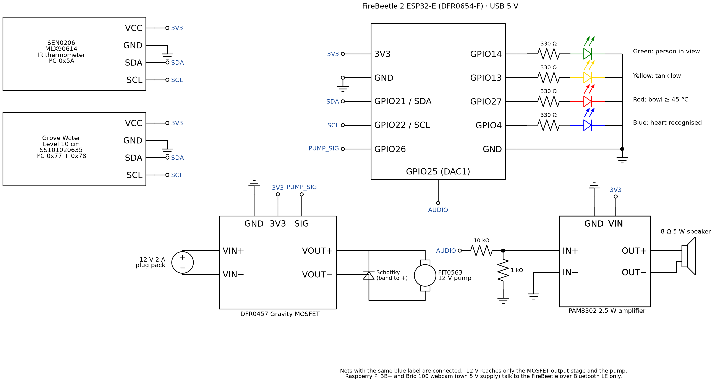

# Campfire Aftercare — COMP5047 Group 23

Raspberry Pi vision and Bluetooth LE, FireBeetle ESP32-E four-LED control, spoken prompts, water/heat sensors, and a 12V water pump.

## Lights and speech

| Output | Meaning |
|---|---|
| Green / GPIO14 | Person detected |
| Yellow / GPIO13 | Low tank level |
| Red / GPIO27 | Object temperature at least 45°C |
| Blue / GPIO4 | Two-hand heart recognised; remains on while held |
| Audio / GPIO25 DAC1 | Spoken prompts and alarm |
| Pump / GPIO26 | MOSFET control signal |

**All LEDs continue to indicate their states while spraying.** Green, yellow, red and blue are independent; spraying does not blank them.

The committed English WAV files and flash-resident samples are generated with macOS Samantha at 155 words/minute:

- [I need more water.](firebeetle/audio/water.wav) — repeats every 5 seconds while the tank is low and someone is in view.
- [The fire is burning. Show me a heart, I'll put it out.](firebeetle/audio/fire.wav) — when a person attends a hot bowl.
- [I love you.](firebeetle/audio/love.wav) — on a new heart gesture.

Playback is offline. The WAV files and generated `AudioSamples.h` are included; macOS is needed only to regenerate them. Audio runs through I2S DMA on GPIO25 in its own task, independently of the control loop and sensor reads. An alarm interrupts speech. A due low-water warning takes priority over another spoken prompt.

## Control sequence

1. No heat (below 45°C): monitor; no pump or alarm. A heart can still light blue and trigger its spoken response.
2. Hot and attended: ask for a heart. A newly recognised heart authorises spraying until the bowl cools, provided water and sensor readings remain valid.
3. Hot and unattended: wait 20 seconds, then alarm for 5 seconds / pause for 5 seconds, three times. After the final pause (50 seconds from the start of absence), spray if still unattended and hot.
4. A returning person stops an alarm or automatic spray and receives the fire prompt. Leaving a manual spray cancels that consent and starts a new unattended grace period.
5. Low water blocks every spray. Invalid/stale water or temperature readings also block spraying. BLE disconnect, stale command stream, or STOP cancels spraying and resets the sequence. A stale camera sends STOP instead of claiming the campsite is empty.

Releasing a heart turns blue off; the authorised attended spray continues until cool, low water, loss of the person, or a stop condition. This implements the report's “until cooled” behaviour rather than requiring the gesture to be held throughout spraying.

Temperature and water are sampled in a separate task roughly every 250 ms, so cooling is checked more frequently than the report's 5-second requirement. The water threshold is the reference raw value >100; two valid samples settle wet/dry. Isolated upper drops are ignored for height, but a film on the bottom segment can still look like water. Water-height precision is not 100 ms: that is a diagnostic polling interval, not measurement accuracy.

## Circuit

The report's existing drawing and visual layout are included unchanged:



[SVG schematic](img/schematic.svg) · [System diagram](img/circuit.svg) · [Drawing source](schematic.py)

| Connection | Wiring |
|---|---|
| Each LED | GPIO → its own 330Ω resistor → anode; cathode → GND |
| Water sensor | White SDA→21, yellow SCL→22, red→3V3, black→GND |
| IR thermometer | SDA→21, SCL→22, VCC→3V3, GND→GND; use module labels |
| DFR0457 control plug | Signal→26, VCC→3V3, GND→GND |
| DFR0457 screw terminals | Supply +12V→VIN; supply negative and pump negative→GND; pump positive→VOUT |
| Flyback diode | Across pump; striped cathode→pump positive, anode→pump negative |
| Makerverse CE08263 audio | GPIO25→10kΩ→IN; IN→1kΩ→GND; both amplifier GND pins→board GND; SD left open |
| Amplifier supply | 3V3 as drawn, or board VCC when powered from 5V USB; begin at low volume |
| Speaker | Both leads to amplifier output +/−; neither lead to GND |

The drawing uses functional input/output labels rather than literal terminal counts. The actual DFR0457 has three power screw terminals, **VIN/GND/VOUT**. Makerverse CE08263 has **IN, signal GND, SD, Vcc, power GND**; its signal GND corresponds to the drawing's grounded input reference. Match the labels on the actual modules.

12V powers only the pump circuit; never connect it to the FireBeetle, Pi or amplifier. The Pi/webcam use their own 5V supply; FireBeetle uses USB power. Keep the existing sensor and pump wires. GPIO25 is reserved for audio.

## Repository layout

- `pi/`: USB camera processing, person/heart recognition, latest-frame capture and BLE client.
- `firebeetle/`: four-LED/voice firmware, state machine, sensor readers, audio clips and C++ tests.
- `hardware-tests/`: standalone diagnostic programs, including 100 ms raw water logging.
- `cad/`: enclosure source scripts and schedules.
- `schematic.py`, `img/`: report circuit diagram and generator.

CAD files are historical design iterations, not an endorsement of every part as fabrication-ready; the older full-print bracket alignment issue is recorded in `cad/campfire-simple-v3/ASSEMBLY_STATUS.txt`. Downloaded model weights and build caches are excluded. Some optional photo/benchmark scripts need locally supplied inputs.

## Raspberry Pi setup

Tested dependency target: Pi 3B+, 64-bit OS, Python 3.11.

```bash
cd pi
python3.11 -m venv .venv
source .venv/bin/activate
python -m pip install -r requirements-pi3.txt
python download_models.py
python app.py --profile pi3 --max-people 1
```

Model downloads are versioned and SHA-256 checked. The USB webcam must be connected to the Pi. The BLE peripheral advertises `Campfire-FireBeetle`. Inference speed and supply stability must be checked on the actual Pi; simulation tests do not verify live camera or BLE operation.

## FireBeetle build and upload

Install PlatformIO, connect FireBeetle 2 ESP32-E, then:

```bash
pio run -d firebeetle
pio device list
pio run -d firebeetle -t upload --upload-port YOUR_SERIAL_PORT
pio device monitor --port YOUR_SERIAL_PORT --baud 115200
```

BLE accepts raw one-byte values: `0` absent, `1` present, `4` heart held, `5` heart released, `6` STOP. USB serial accepts those ASCII digits. USB commands expire unless refreshed; the Pi refreshes commands automatically. Serial `w`, `f`, `l` tests the three voice clips without intentionally enabling the pump.

The physical pump requires a MOSFET module and independent 12V supply. Diagnostic GPIO26 blink/wiring programs can activate the attached pump; use the appropriate firmware for the connected hardware.

## Tests

```bash
(cd pi && python3 -m unittest discover -s tests -p 'test_*.py')
c++ -std=c++11 firebeetle/tests/control_test.cpp -o /tmp/campfire-control-test
/tmp/campfire-control-test
pio run -d firebeetle
```

Tests cover LED states during pumping, manual consent, absent-person timing, return cancellation, dry/unknown-water lockout, cooling, communication loss, time wraparound, and camera/gesture policies. They do not constitute a physical water-flow, acoustic clarity, or end-to-end hardware test. This four-LED/voice build has been compiled and simulation-tested, and has not been uploaded to the physical board in this session.

## Regenerate diagrams or speech

```bash
python3 -m pip install -r requirements-diagram.txt
python3 schematic.py
# macOS only; bundled WAV/header files are already usable elsewhere:
python3 firebeetle/audio/build_audio.py
```

The generator writes beside itself regardless of the current working directory. The original report file is not modified.

## References

[FireBeetle](https://wiki.dfrobot.com/dfr0654/) · [MOSFET](https://wiki.dfrobot.com/dfr0457) · [Makerverse amplifier](https://core-electronics.com.au/makerverse-pam8302-2-5w-mono-amplifier.html) · [Water sensor](https://wiki.seeedstudio.com/Grove-Water-Level-Sensor/)

This is a supervised classroom prototype, not a validated fire-extinguishing device.
